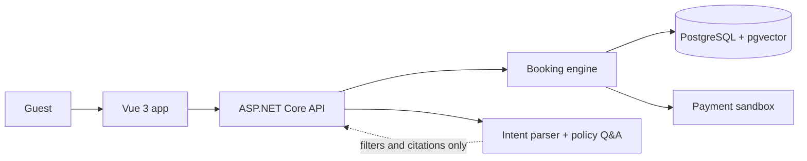

# VenueFlow

**Conversational booking for flexible spaces and workshops.** VenueFlow is a two-sided booking marketplace: hosts publish bookable time slots for studios, workshop rooms and coworking spaces, and guests search in plain language. The booking engine alone controls availability and price.

> **Status:** early development, following a 7-week roadmap (see below). It uses synthetic venues and demo reservations. Payments are simulated; no cards are collected.

## The problem

Someone looking for "a quiet, wheelchair-accessible room for a workshop" has to turn that into rigid filters, then check availability and house rules by hand. VenueFlow lets them describe what they need and turns it into filters they can see and edit, while every slot, price and policy comes from real host data.

## Who it's for

- **Guests:** find and book spaces
- **Venue hosts:** manage spaces, schedules, pricing and policies
- **Staff:** check guests in and resolve disputes
- **Admins:** moderate listings

## Demo workflow

1. Type: "A step-free creative workshop space for 10 near downtown, Saturday after 2, under $150"
2. See it turned into visible, editable search filters
3. Pick a real available slot and hold it for a short time
4. Confirm the booking and receive a demo QR code and calendar file
5. When someone cancels, the next person on the waitlist gets an offer

## Planned features

- Host listing workflow with schedules and time-based inventory
- Correct time zone and daylight-saving handling
- Pricing, fees and discovery filters
- Short-lived holds and transactional booking confirmation
- Cancellations, simulated refunds and host operations
- AI that turns a plain-language search into structured, editable filters
- Explained recommendations among slots that are actually available
- Policy Q&A over host documents, with citations ("Can we bring food?")
- Waitlists with offers that never overbook
- Notifications, QR check-in codes and calendar files

## Tech stack

| Layer | Technology |
|---|---|
| Frontend | Vue 3, TypeScript, Composition API, Pinia |
| Backend | ASP.NET Core, EF Core |
| AI integration | Microsoft.Extensions.AI |
| Database | PostgreSQL with pgvector |
| Cache | Redis |
| Payments | Optional payment-sandbox adapter |
| Local environment | Docker Compose |

## Architecture



## Design rules

- Capacity is never double-sold, even under concurrent bookings.
- AI never invents a venue, time slot or price; it only works with real search results.
- Accessibility details are shown exactly as the host provided them.
- Policy answers cite host documents, or say "not specified".
- Each booking stores a snapshot of the quoted price and fees.
- Expired holds are released, and waitlist offers never overbook.

## Roadmap

| Week | Focus | Status |
|---|---|---|
| Week 1 | **Domain design, Vue/.NET scaffolding** — Add domain design docs and Vue 3 app shell, bootstrap ASP.NET Core API with health route, EF Core and Compose, seed demo venues with IANA timezones and document setup | Planned |
| Week 2 | **Host listings & schedules** — Add host accounts, venue drafts and publication workflow, add opening rules, schedule exceptions and DST-safe slots, add Vue host calendar with closures and capacity | Planned |
| Week 3 | **Pricing, holds & booking** — Add price rules, service fees and quote snapshots, add transactional holds and idempotent confirmation, add Vue booking review with hold countdown | Planned |
| Week 4 | **Cancellations & host operations** — Add cancellation windows and simulated refunds, add host dashboard for upcoming bookings and check-ins | Planned |
| Week 5 | **AI search & staging** — Parse search intent into validated, editable filters, add hold-expiry cleanup and outbox relay, deploy staging with HTTPS and secrets | Planned |
| Week 6 | **Policy Q&A & waitlists** — Add versioned venue policy chunks and embeddings, add waitlist entries and expiring offers, add Vue waitlist opt-in and offer screens | Planned |
| Week 7 | **Security, load testing & release** — Audit role policies and resource checks, run concurrent booking and input security scans, add release acceptance checklist and changelog, ship demo with synthetic slots and monitoring | Planned |

## Getting started

Needs Docker (with Compose), the .NET SDK from `global.json`, and Node.js with pnpm.

```bash
scripts/dev.sh setup   # start PostgreSQL + Redis, apply migrations, seed two demo venues
scripts/dev.sh api     # API on http://127.0.0.1:5080
scripts/dev.sh web     # Vue app on http://127.0.0.1:5173
```

Details, demo data and tests: [docs/setup/getting-started.md](docs/setup/getting-started.md).

## Documentation

- [Getting started](docs/setup/getting-started.md)
- [Personas](docs/domain/personas.md)
- [Capacity invariants](docs/domain/capacity-invariants.md)
- [ADR 0001: Vue + .NET modular monolith](docs/adr/0001-vue-dotnet-modular-monolith.md)
