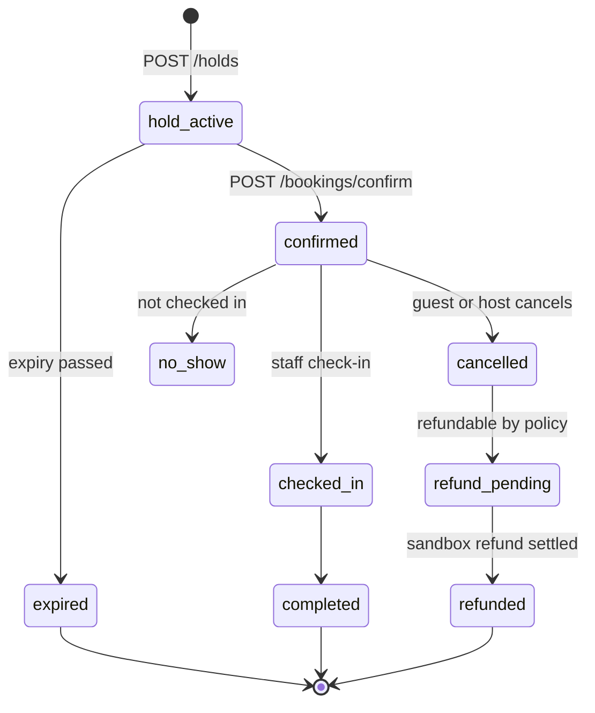
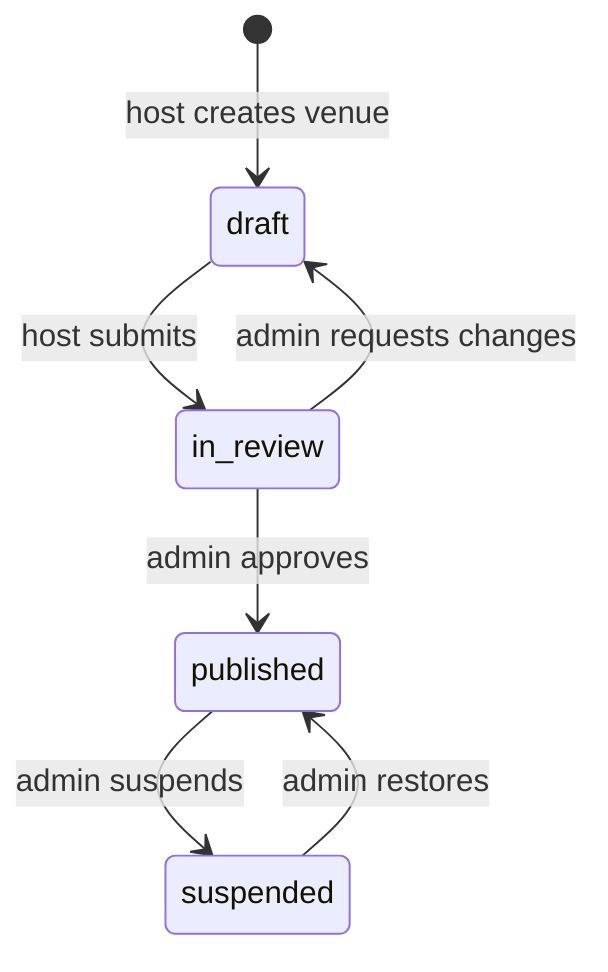

# Capacity invariants and booking lifecycle

These rules define correct behaviour for the booking engine. Every later feature (holds, waitlists, cancellations, AI search) must keep them true, and each one gets an automated test.

## Terms

| Term | Meaning |
|---|---|
| Resource | A bookable unit inside a venue: a room (`room` mode) or a class/session with seats (`class` mode) |
| Slot | A time interval on a resource with a total capacity. Stored as UTC instants plus the venue's IANA timezone |
| Hold | A temporary claim on capacity with a server-side expiry |
| Booking | A confirmed claim created from exactly one active hold |
| Quote | An immutable price snapshot for a slot and quantity, with its own expiry |

## Invariants

1. **No overselling.** For every slot, at commit time:
   `confirmed_quantity + active_unexpired_held_quantity ≤ total_capacity`.
2. **Room mode has no overlaps.** A room resource has capacity 1, and no two confirmed or actively held intervals on the same resource overlap. Enforced in PostgreSQL (exclusion constraint or a serialized per-resource transaction), not by comparing slot IDs.
3. **Class mode counts seats.** Seats are taken with a row lock or conditional update on the slot, never by reading a count and writing later.
4. **Only the database decides.** Search results, cached availability, vector search and AI output never reserve capacity. A slot shown in search can still return `409 inventory_unavailable` on hold.
5. **Holds expire on the server.** Expiry is checked inside the hold/confirm transaction; a background worker also releases expired holds. A client timer is only a display.
6. **Confirmation is idempotent.** A booking is confirmed exactly once per `(user, idempotency_key)`. Retrying with the same key returns the same booking.
7. **Prices are frozen.** A booking references the quote it was confirmed with. Quotes are computed on the server in minor units; the client, the AI and request bodies cannot set a price.
8. **Time is unambiguous.** Instants are stored in UTC with the venue's IANA timezone. Local times that do not exist (spring-forward gap) are rejected; ambiguous local times (fall-back overlap) are resolved by an explicit, documented rule.
9. **Waitlist offers are real holds.** An offer creates a hold on the freed capacity, so it is subject to invariant 1.
10. **Schedule changes never drop bookings silently.** Closing a window that contains a booking requires an explicit host/admin resolution.
11. **Consistent lock order.** Transactions that touch several slots lock them in ascending slot id order to avoid deadlocks. No model or network call runs while a lock is held.

## Booking lifecycle



## Hold and confirm flow

```mermaid
sequenceDiagram
  participant G as Guest (Vue)
  participant A as API
  participant DB as PostgreSQL
  G->>A: POST /quotes (slot, quantity)
  A->>DB: compute price from price rules
  A-->>G: quote (total, expires_at)
  G->>A: POST /holds (slot, quantity, quote)
  A->>DB: BEGIN; lock slot row; check invariant 1
  alt capacity available
    A->>DB: insert hold (expires_at); COMMIT
    A-->>G: 201 hold
  else not enough capacity
    A->>DB: ROLLBACK
    A-->>G: 409 inventory_unavailable
  end
  G->>A: POST /bookings/confirm (hold, quote, Idempotency-Key)
  A->>DB: BEGIN; lock hold; check not expired; insert booking; outbox event; COMMIT
  A-->>G: booking + confirmation code
```

## Venue listing lifecycle



## Test checklist

| # | Invariant | Planned test |
|---|---|---|
| 1 | No overselling | 50 concurrent holds on a 10-seat slot → exactly 10 succeed |
| 2 | Room overlaps | Overlapping holds on one room → second gets 409 |
| 5 | Hold expiry | Confirm after expiry → rejected; capacity released |
| 6 | Idempotency | Same key confirmed twice → one booking, same response |
| 7 | Frozen price | Price rule changed after quote → booking keeps quoted total |
| 8 | DST | Slot in a spring-forward gap → rejected; fall-back slot → resolved per rule |
| 9 | Waitlist | Offer accepted after capacity refilled → no oversell |
