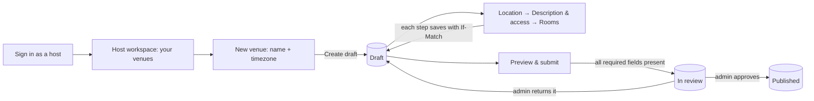

# Host onboarding

How a host gets a venue from nothing to a listing in review, what the app checks along the way, and which wording to use for access features. Everything here works on the local stack with the synthetic demo data (see [Getting started](../setup/getting-started.md)).

## The flow



1. **Sign in** at `/sign-in` with `host@example.test` and `DEMO_PASSWORD` from `infra/compose/.env`. Only host accounts can open the host workspace; guests, staff and admins are sent back to the search page, and the API answers them `403`.
2. **Host workspace** (`/host`) lists your own venues with city, room count and status. Venues of other hosts never appear.
3. **New venue** asks for a name and an IANA timezone (the browser's zone is preselected when it is in the list). *Create draft* saves it as a **Draft** and moves you to its edit page.
4. **Steps.** Moving to another step saves the current one. Optional fields may stay empty while drafting:
   - **Location**: city (shown to guests) and street address (only sent to guests with their booking confirmation).
   - **Description & access**: free-text description and accessibility notes; the buttons under the notes add the suggested labels below.
   - **Rooms**: each bookable room with a name (unique within the venue) and capacity from 1 to 1000; up to 50 rooms.
5. **Preview & submit** shows the listing the way guests will see it (without the street address) and lists anything still missing. *Submit for review* is enabled once description, city, street address and at least one room are filled in.
6. **In review**: the listing is locked. An admin either approves it (**Published**, guests can find it) or returns it to **Draft** for changes. The admin review screen comes later; the demo venues are already published by the seed.

## What is checked

| Situation | What the host sees | API answer |
|---|---|---|
| Opening another host's venue (by link or guessed id) | "This venue does not exist or belongs to another host." — form disabled | `404 venue_not_found`, identical to an unknown id |
| Guest, staff or admin opening a host page | Sent back to the search page | `403` |
| Signed out | Sent to sign-in, then back | `401` |
| Saving after someone else saved the same venue | "Someone else changed this venue since you opened it…" | `412 revision_mismatch` |
| Request without `If-Match` (only outside the app) | — | `428 if_match_required` |
| Submitting with fields missing | Missing fields listed on the preview step; button disabled | `422 venue_incomplete` |
| Editing a venue in review or published | "This venue is in review / published, so it can no longer be edited here." | `409 venue_not_editable` |
| Submitting a venue that is already in review or published | — | `409 venue_status_transition_invalid` |
| Reusing a room id from another venue | — | `422 room_not_found` |

These cases are covered by `services/api/tests/VenueFlow.Tests/Api/VenueAccessAndTransitionTests.cs`, `Domain/VenueStatusTransitionTests.cs` and the Playwright tests in `apps/web/e2e/`.

## Accessibility labels

Accessibility notes are shown to guests exactly as written, so hosts can describe anything that matters. To keep the common cases consistent across listings, the wizard offers these labels; each button appends the label as its own sentence and is disabled once the label is already in the notes. Only add a label when it is true for the whole venue, and add details in your own words (which entrance, where the lift is, etc.).

| Label | Use it when |
|---|---|
| Step-free entrance | Guests can get from the street to the rooms without steps (level access or a permanent ramp). |
| Lift to all floors | Every floor with a bookable room is served by a lift. |
| Accessible toilet | There is a wheelchair-accessible toilet guests can use during the booking. |
| Hearing loop | An induction loop is installed in at least one room; say which ones. |
| Seating with back and arm rests | Chairs with back and arm rests are available on request or by default. |
| Quiet room available | A low-noise, low-light space guests can step into during an event. |
| Assistance dogs welcome | Assistance dogs are allowed in all rooms. |
| Accessible parking nearby | Accessible parking spaces are within a short, step-free walk; say where. |

Example (from the Riverside Makers Studio seed): *"Step-free entrance from the street. Accessible toilet on the same floor."*

The list lives in `apps/web/src/venues/accessibilityLabels.ts`. It is wording help only: the API stores free text and does not filter by label yet.

## Trying it end to end

With the API running (`scripts/dev.sh api`):

```bash
scripts/dev.sh e2e
```

This installs Chromium for Playwright if needed and runs `apps/web/e2e/` against the local stack (Playwright starts the Vue dev server unless one is already running). The tests:

- sign in as `host@example.test`, create a draft, fill in every step (using two accessibility labels), check the preview hides the street address, submit it and find it **In review** in the workspace — a screenshot of the preview is attached to the report;
- sign in as `other-host@example.test`, open the demo host's venue and check the form stays disabled and a direct `PUT` gets `404`;
- sign in as `guest@example.test` and check the host page redirects and the API answers `403`;
- check the seeded venue is still published and unchanged for its owner.

Each run adds one new draft (named `E2E studio <timestamp>`) to the demo host. `scripts/dev.sh reset` and `setup` clear them. CI runs the same tests against PostgreSQL and Redis in the `e2e` job and keeps the HTML report as an artifact.
